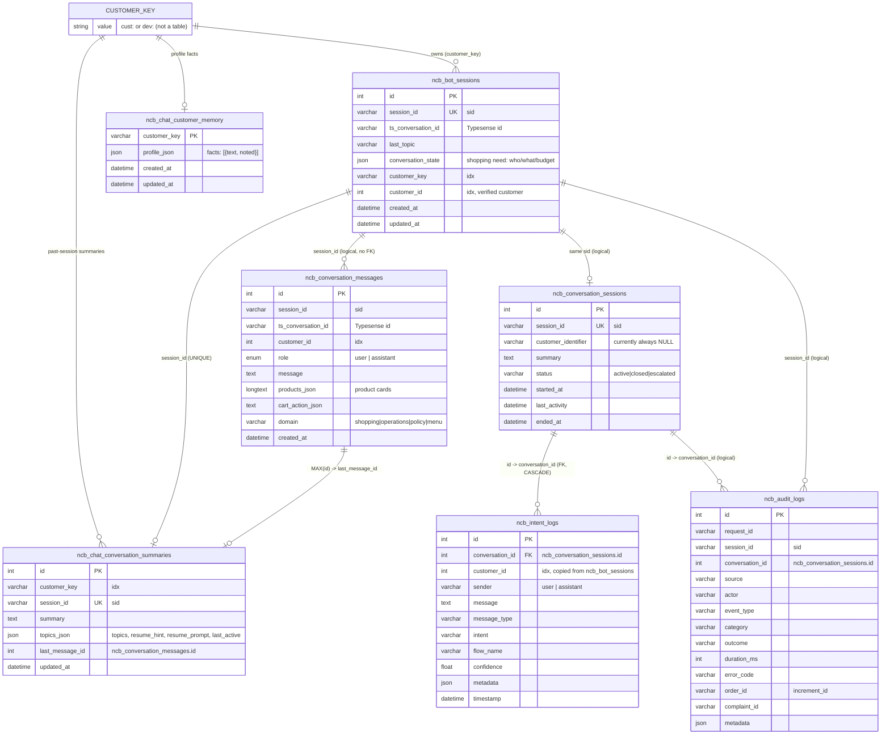

# NiaBot Database Guide

How NiaBot's MySQL tables relate to each other, which chat messages go into which table, and how the session and customer identifiers connect them.

> Source of truth: [SQL_SETUP.sql](../SQL_SETUP.sql), [migrations/](../migrations/), and the SQL in the repositories listed in each section. If you change a table, update this guide too.

---

## 1. The big picture

NiaBot uses **one MySQL database** ([config/database.py](../config/database.py)), reached through one shared connection pool ([database/connection.py](../database/connection.py), `DatabaseManager`). That database holds two kinds of tables:

| Group | Owner | What NiaBot does with it |
|---|---|---|
| **NiaBot tables**, all prefixed **`ncb_`**: `ncb_bot_sessions`, `ncb_conversation_messages`, `ncb_conversation_sessions`, `ncb_intent_logs`, `ncb_chat_customer_memory`, `ncb_chat_conversation_summaries`, `ncb_audit_logs` (+ legacy `ncb_cart_items`, `ncb_orders`, `ncb_order_items`, view `ncb_v_cart_summary`) | NiaBot | Reads and writes |
| **Naheed / Magento tables**: `sales_order*`, `sales_creditmemo`, `nhd_*`, `nop_*`, `catalog_*`, `eav_*` | The Naheed.pk store | Mostly reads (order tracking, refunds). Writes only to **cancel an order** and **create complaint tickets** |

Product search runs in **Typesense**, not MySQL. Policy answers come from a **Chroma** vector store. Neither is covered here.

Operations flow state (the current flow, the verified order) is held **in process memory** ([core/state_manager.py](../core/state_manager.py)), not in the database. It is lost on restart and is not shared between workers.

### Old → new table names

| Old name | New name |
|---|---|
| `cart_sessions` | `ncb_bot_sessions` |
| `conversation_messages` | `ncb_conversation_messages` |
| `conversation_sessions` | `ncb_conversation_sessions` |
| `chatbot_messages` | `ncb_intent_logs` |
| `chat_customer_memory` | `ncb_chat_customer_memory` |
| `chat_conversation_summaries` | `ncb_chat_conversation_summaries` |
| `audit_logs` | `ncb_audit_logs` |
| `cart_items` / `orders` / `order_items` (legacy) | `ncb_cart_items` / `ncb_orders` / `ncb_order_items` |
| view `v_cart_summary` (legacy) | view `ncb_v_cart_summary` |

---

## 2. The identifiers (read this first)

| Identifier | Example | Created by | Lives in | Meaning |
|---|---|---|---|---|
| **`sid`** (session id) | `3f2a…-uuid` | Browser ([templates/index.html](../templates/index.html), `localStorage.npk_session_id`) | `session_id` column of `ncb_bot_sessions`, `ncb_conversation_messages`, `ncb_conversation_sessions`, `ncb_chat_conversation_summaries`, `ncb_audit_logs` | **One chat thread.** "New Chat" creates a new `sid`. This is the **main join key** across NiaBot tables. |
| **`ts_conversation_id`** (string) | `a1b2c3…` | Typesense (shopping), or a fallback UUID in [app.py](../app.py) | `ncb_bot_sessions.ts_conversation_id`, `ncb_conversation_messages.ts_conversation_id` | Typesense's conversational-search thread. The API and the browser (`localStorage.npk_conversation_id`) still call it `conversation_id`. |
| **`conversation_id`** (INT) | `1042` | MySQL auto-increment `ncb_conversation_sessions.id` | `ncb_intent_logs.conversation_id`, `ncb_audit_logs.conversation_id` | Internal numeric key of the operations/policy session. In the database, `conversation_id` **always** means this now. |
| **`customer_id`** (INT UNSIGNED) | `12345` | Taken from a verified `cust:<id>` key ([services/memory_service.py](../services/memory_service.py) `customer_id_from_key()`) | `ncb_bot_sessions`, `ncb_conversation_messages`, `ncb_intent_logs` | The Naheed customer id of a **logged-in, verified** customer. NULL for guests, device-only visitors, and non-numeric ids. |
| **`device_id`** | `k3j2-…` | Browser (`localStorage.npk_device_id`) | Not stored directly; becomes `customer_key = "dev:<id>"` | One browser profile. Kept when the user starts a New Chat. |
| **`customer_token`** | `12345.<hmac hex>` | Host website (signed with `CUSTOMER_TOKEN_SECRET`) | Not stored; once verified it becomes `customer_key = "cust:<id>"` | Logged-in Naheed customer |
| **`customer_key`** | `cust:12345` / `dev:k3j2-…` | `resolve_customer_key()` in memory_service | `ncb_bot_sessions`, `ncb_chat_customer_memory`, `ncb_chat_conversation_summaries` | **Who the person is**, guest or logged in. Links many `sid`s to one person for memory and cross-device history. |
| **Order `increment_id`** | `100234567` | Magento | `sales_order.increment_id`, `nhd_complain_tickets.order_number`, `ncb_audit_logs.order_id` | Order number the customer sees |
| **Order `entity_id`** | `808123` | Magento | `sales_order.entity_id`, and the `order_id` / `parent_id` columns in Magento child tables | Magento's internal order key |

`customer_key` vs `customer_id`: memory and history logic uses `customer_key` because it also covers guests (`dev:`). `customer_id` exists for reporting and joins: "all chats of customer 12345" is a plain integer lookup.

---

## 3. ERD

### 3.1 NiaBot tables



**Only one real foreign key exists:** `ncb_intent_logs.conversation_id → ncb_conversation_sessions.id`. Every other link is a **logical join on `sid`, `customer_key` or `customer_id`** done in code. MySQL will not stop orphan rows, and deleting an `ncb_bot_sessions` row does **not** delete its messages.

### 3.2 Naheed / Magento tables NiaBot touches

```mermaid
erDiagram
    sales_order ||--o{ sales_order : "relation_parent_id (split child orders)"
    sales_order ||--o{ sales_order_item : "entity_id = order_id"
    sales_order ||--o{ sales_order_address : "entity_id = parent_id (shipping)"
    sales_order ||--|| sales_order_payment : "entity_id = parent_id"
    sales_order ||--o| nhd_sales_order_additionals : "entity_id = order_id"
    sales_order ||--o{ sales_creditmemo : "entity_id = order_id (refunds)"
    sales_order ||--o{ sales_order_status_history : "written on cancel"
    sales_order ||--|| sales_order_grid : "updated on cancel"
    sales_order }o--|| sales_order_status : "status -> label"
    sales_order ||--o| nop_order_shipment : "increment_id = ordernumber"
    nop_order_shipment }o--o| nop_riders : "rider_id"
    sales_order ||--o{ nop_refund_products_info : "increment_id = ordernumber"
    sales_order ||--o{ nhd_complain_tickets : "increment_id = order_number, entity_id"
    nhd_complain_tickets ||--o{ nhd_complain_tickets_products_info : "ticket_no"
    nhd_complain_tickets ||--o{ nhd_complain_tickets_attachments_info : "ticket_no"
    sales_order_item }o--|| catalog_product_entity_varchar : "product_id (image via eav_attribute)"
```



The queries live in [database/repository.py](../database/repository.py) (`OrderRepository`, `ComplaintRepository`) and [data/repositories/complaint_tracking_repository.py](../data/repositories/complaint_tracking_repository.py).

Bridges between chat tables and Magento data:
- `customer_id` in `ncb_bot_sessions`, `ncb_conversation_messages` and `ncb_intent_logs` is the Magento customer id when the host site sends a signed token.
- `ncb_audit_logs.order_id` / `ncb_audit_logs.complaint_id` (with `ncb_audit_logs.session_id`).
- `ncb_intent_logs.metadata`, which may hold the verified order.

---

## 4. Which messages go into which table

Every chat turn passes through `POST /api/chat` ([app.py](../app.py)). The [domain router](../router/domain_router.py) sends it to the **shopping**, **operations**, **policy** or **menu** domain.

| What happens | `ncb_conversation_messages` | `ncb_intent_logs` (+ `ncb_conversation_sessions`) | Other tables |
|---|---|---|---|
| **Shopping** turn (product search, follow-up, "show more") | ✅ user + assistant, `domain='shopping'`, `products_json` = product cards shown | ❌ | `ncb_bot_sessions.ts_conversation_id`, `last_topic`, `conversation_state` updated |
| **Operations** turn (track order, cancel, complaint, refund, modify) | ✅ user + assistant, `domain='operations'` | ✅ user row with `intent`, `flow_name`, `confidence`; assistant row with debug `metadata` | `ncb_audit_logs` events; Magento writes when cancelling or filing a complaint |
| **Policy / FAQ** turn (RAG) | ✅ `domain='policy'` | ✅ `intent='policy_query'`, `flow_name='policy'`, assistant `metadata` = `{domain, entry, model, grounded, standalone_question, sources[]}` | — |
| **Menu** turn (numbered menu) | ✅ `domain='menu'` | depends on whether operations handled it | — |
| Operations **early rejections** (rate limit, too many words, "wait for my reply", cancel/reset) | ✅ (written by app.py) | ✅ | `ncb_audit_logs` (`RATE_LIMIT` / `SECURITY`) |
| Goodbye flow ends the conversation | ✅ | ✅, then `ncb_conversation_sessions.status='closed'`, `ended_at` set | — |
| Customer states a lasting fact ("my son is 25") | ✅ | — | `ncb_chat_customer_memory.profile_json` (written in the background) |
| A session has been idle for `MEMORY_IDLE_MINUTES` | — | — | `ncb_chat_conversation_summaries` row upserted; profile facts consolidated |

### In short
- **`ncb_conversation_messages`** is the **complete, unified transcript** of every turn from every domain. It drives `/api/history` (restoring the chat UI), the short-term context for the shopping model, "show more" de-duplication, and session summaries. Written by `save_conversation_message()` in [domains/shopping/repository.py](../domains/shopping/repository.py).
- **`ncb_intent_logs`** records **what the bot understood** in operations and policy turns: intent, flow, confidence and RAG sources. Shopping turns never go here. Written in the background by [services/conversation_service.py](../services/conversation_service.py) through [data/repositories/conversation_repository.py](../data/repositories/conversation_repository.py).
- So **operations and policy turns are stored twice**, once in each table, for different purposes.

All of these writes are **best-effort**: errors are logged and swallowed, so a database failure never blocks a chat reply.

---

## 5. How a `/api/chat` request touches the database

```
Browser ── {message, sid, conversation_id, device_id, customer_token} ──▶ POST /api/chat
  1. ensure_bot_session(sid, conv_id)       INSERT IGNORE ncb_bot_sessions (ts_conversation_id)
  2. resolve_customer_key(device, token)    -> "cust:<id>" | "dev:<id>" | None   (no DB)
  3. Shared-PC guard: session_owner(sid)    SELECT ncb_bot_sessions.customer_key
        a different cust: owns this sid?    -> 409 "Your session has changed"
  4. link_session(sid, customer_key)        UPDATE ncb_bot_sessions.customer_key, customer_id
        + background summarize_pending()    -> ncb_chat_conversation_summaries, ncb_chat_customer_memory
  5. domain_router.route_message(...)
        shopping   -> ncb_bot_sessions.conversation_state/last_topic, reads ncb_conversation_messages
        operations -> sales_order*, nhd_complain_tickets*, ncb_intent_logs, ncb_audit_logs
        policy     -> ncb_intent_logs
        (ncb_intent_logs.customer_id is copied from ncb_bot_sessions by sid on insert)
  6. save_conversation_message(user)        INSERT ncb_conversation_messages (+ customer_id)
     save_conversation_message(assistant)   INSERT ncb_conversation_messages (+ products_json, customer_id)
```

---

## 6. How the customer ID is used

### 6.1 Resolving the customer
`resolve_customer_key()` in [services/memory_service.py](../services/memory_service.py):
1. If the host site sent `customer_token = "<customer_id>.<HMAC-SHA256(CUSTOMER_TOKEN_SECRET, customer_id)>"` and the signature matches, the key is **`cust:<customer_id>`**.
   Raw customer ids are never trusted: they are sequential, so accepting them would expose other customers' memory.
2. Otherwise, if a valid `device_id` was sent, the key is **`dev:<device_id>`**.
3. Otherwise, or if `MEMORY_ENABLED` is off, the key is `None`. Long-term memory is skipped, but in-session context still works.

`customer_id_from_key()` turns `cust:12345` into the integer `12345` for the `customer_id` columns. Every other key gives NULL, and so does a non-numeric id or one larger than INT UNSIGNED. Because it is derived from the key, `customer_id` is also NULL when `MEMORY_ENABLED` is off.

### 6.2 Linking a session to a customer
`link_session()` sets `ncb_bot_sessions.customer_key` and `customer_id`. It follows these rules:
- A `dev:` key **can be upgraded** to `cust:` (the user logs in partway through a chat). Messages saved before the login keep `customer_id = NULL`.
- A session already owned by `cust:A` is **never reassigned** to `cust:B` or to a `dev:` key, which protects shared PCs.

### 6.3 Cross-device history (`GET /api/history?sid=…&ct=<token>`)
[domains/shopping/routes.py](../domains/shopping/routes.py):
- With a valid `cust:` token, the server finds the customer's **most recently active `sid`** on any device (`latest_session_for()`: `ncb_bot_sessions` joined with `ncb_conversation_messages`, ordered by `MAX(cm.id)`) and returns that conversation. The browser then switches to the returned `sid`.
- If the browser just pressed **New Chat** (`new_chat=1`), the server keeps the new `sid` instead.
- If the browser's `sid` belongs to **a different** `cust:`, the server returns a brand-new `sid` instead of the other customer's chat.
- `dev:` keys **never** switch sessions. Only a signed customer id can do that.

### 6.4 Long-term memory
| Table | Keyed by | Contents | Used for |
|---|---|---|---|
| `ncb_chat_customer_memory` | `customer_key` (PK) | `profile_json = {"facts": [{"text": "Has a son, about 25", "noted": "2026-11-01"}]}`, capped at `MEMORY_MAX_FACTS` | Personalizing shopping replies |
| `ncb_chat_conversation_summaries` | `session_id` (UK) + `customer_key` | 2–3 sentence summary; `topics_json` = topics, `resume_hint`, `resume_prompt`, `last_active` | "Welcome back" (`POST /api/welcome`) and "what did I look at last time?" |

A session is (re)summarized once its newest `ncb_conversation_messages.id` is greater than `last_message_id` **and** it has been idle for `MEMORY_IDLE_MINUTES`.

### 6.5 Forget me (`POST /api/memory/forget`)
This deletes the customer's `ncb_chat_customer_memory` and `ncb_chat_conversation_summaries` rows and sets `ncb_bot_sessions.conversation_state`, `customer_key` and `customer_id` to NULL.
⚠️ It does **not** delete `ncb_conversation_messages` or `ncb_intent_logs`, and their `customer_id` values stay as they are.

---

## 7. Table reference

### NiaBot-owned

| Table | Defined in | Written by | Purpose |
|---|---|---|---|
| `ncb_bot_sessions` | SQL_SETUP.sql + `add_conversation_memory.sql` + `add_ts_conversation_id_and_customer_id.sql` | shopping repository, memory_service | **One row per `sid`.** Holds the Typesense thread (`ts_conversation_id`), last topic, structured shopping state, the owner `customer_key` and `customer_id`. |
| `ncb_conversation_messages` | SQL_SETUP.sql + `add_policy_domain_columns.sql` + `add_ts_conversation_id_and_customer_id.sql` | `app.py` → `save_conversation_message()` | Unified transcript (see §4) |
| `ncb_conversation_sessions` | SQL_SETUP.sql | ConversationService | One row per `sid`, for the operations and policy log. Tracks `status` (active/closed/escalated) and timestamps. |
| `ncb_intent_logs` | SQL_SETUP.sql + `add_ts_conversation_id_and_customer_id.sql` | ConversationService | Operations and policy turns with intent, flow, confidence and metadata (see §4) |
| `ncb_chat_customer_memory` | `add_conversation_memory.sql` | memory_service | Long-term facts per customer |
| `ncb_chat_conversation_summaries` | `add_conversation_memory.sql` | memory_service | One summary per past session |
| `ncb_audit_logs` | SQL_SETUP.sql | [services/audit_service.py](../services/audit_service.py) | Security and system events (rate limits, exceptions, order and complaint actions), with `request_id`, `session_id`, `order_id`, `complaint_id` |

### Legacy (defined, but no longer written)
`ncb_cart_items`, `ncb_orders`, `ncb_order_items` and the view `ncb_v_cart_summary` come from the old standalone shopping bot. "+ Add" now goes straight to the Magento cart through [static/niabot-widget.js](../static/niabot-widget.js). `memory_service._transcript()` still *reads* `ncb_cart_items` and `ncb_orders` if they exist. They can be dropped if you don't need the old data.

### Naheed / Magento (external)

| Table | NiaBot uses it for |
|---|---|
| `sales_order` | Order lookup by `increment_id`, parent and child split orders (`relation_parent_id`, `relation_parent_real_id`), **cancel** (UPDATE) |
| `sales_order_item` | Items in an order, unavailable items (parent qty − child qty), items for a complaint |
| `sales_order_address` | Shipping phone, used to verify the customer, and the shipping address |
| `sales_order_payment` | Payment method |
| `sales_order_status`, `sales_order_grid`, `sales_order_status_history` | Status labels; kept in sync on cancel |
| `sales_creditmemo`, `nop_refund_products_info` | Refund state, amount and date |
| `nhd_sales_order_additionals` | Estimated or completed delivery, courier info |
| `nop_order_shipment`, `nop_riders` | Rider name and phone |
| `nhd_complain_tickets` (+ `_products_info`, `_attachments_info`) | **Created** by the complaint flow; read by complaint tracking |
| `catalog_product_entity_varchar`, `eav_attribute`, `eav_entity_type` | Product image for complaint item cards |

---

## 8. Gotchas and known gaps

1. **API vs DB naming.** The HTTP API and browser `localStorage` still call the Typesense id `conversation_id`. In the database it is `ts_conversation_id`, and `conversation_id` means `ncb_conversation_sessions.id`.
2. **`ncb_conversation_sessions.customer_identifier` is never filled in.** Use `customer_id` (or `ncb_bot_sessions.customer_key` for guests).
3. **No foreign keys on `sid`.** Messages, summaries and audit rows can outlive their `ncb_bot_sessions` row.
4. The code refers to `migrations/add_priority_mood_to_complain_tickets.sql`, which does not exist. The `priority` column must already exist on `nhd_complain_tickets`.
5. `mood` is used to raise ticket priority but is **not stored**. Only `priority` is saved on `nhd_complain_tickets`.
6. Message writes run in **background threads** (ConversationService, AuditService, memory). Under load, `ncb_intent_logs` rows can land slightly out of order compared with `ncb_conversation_messages`.

---

## 9. Handy queries

```sql
-- Full transcript of one chat
SELECT id, role, domain, message, created_at
FROM ncb_conversation_messages WHERE session_id = '<sid>' ORDER BY id;

-- All chats for a logged-in customer
SELECT session_id, MIN(created_at) AS started, MAX(created_at) AS last_msg, COUNT(*) AS msgs
FROM ncb_conversation_messages
WHERE customer_id = 12345
GROUP BY session_id ORDER BY last_msg DESC;

-- What the bot understood in one chat (operations / policy turns)
SELECT il.sender, il.message, il.intent, il.flow_name, il.confidence, il.timestamp
FROM ncb_conversation_sessions s
JOIN ncb_intent_logs il ON il.conversation_id = s.id
WHERE s.session_id = '<sid>'
ORDER BY il.id;

-- What the bot remembers about a customer
SELECT profile_json FROM ncb_chat_customer_memory WHERE customer_key = 'cust:12345';
SELECT session_id, summary, topics_json FROM ncb_chat_conversation_summaries
WHERE customer_key = 'cust:12345' ORDER BY last_message_id DESC;

-- Intent distribution for operations and policy
SELECT intent, flow_name, COUNT(*) FROM ncb_intent_logs
WHERE sender = 'user' GROUP BY intent, flow_name ORDER BY 3 DESC;

-- Traffic per domain
SELECT domain, COUNT(*) FROM ncb_conversation_messages WHERE role = 'user' GROUP BY domain;
```
